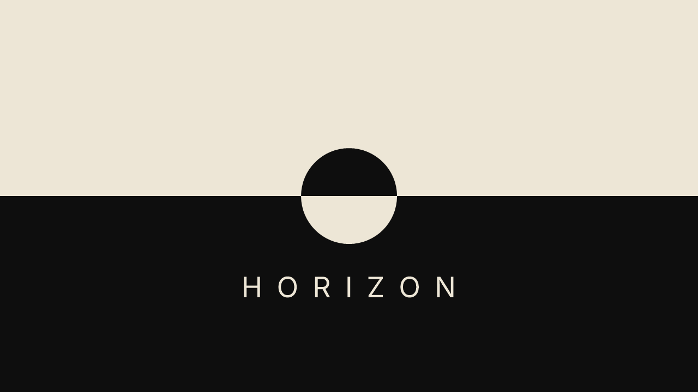

# Horizon — a launcher for Fire TV

A calm, design-led home screen for Amazon Fire TV sticks, with nine themes:

- **Editorial** — every app a magazine cover: your own photos, a library of cover styles (Masthead, Split, Interview, Quarterly, Monograph, Objects, Plate, Guide…), one typography across every page, and an always-on slideshow
- **Passive** — a quiet page of words over a carousel of photographs that open as you move, with a clock chip that becomes a Now Playing card
- **Swatch** — your apps as a mosaic of paint-swatch colour blocks, with a clock hero, colour presets and seasons
- **Tile** — the same idea as rounded colour cards with gaps, like a palette sheet
- **Tabs** — bright stacked tabs with big bold names that open as you move
- **Scroll** — a quiet list of names beside big grainy gradient art (or your own gradients)
- **Classic** — a full-screen photo with a dock of apps
- **Dots** — a dot-matrix screen where light follows you
- **Halloween** — one video of your choice, full screen and looping (a party backdrop), with what's playing; Select opens Spotify

Each theme has its own colours, type and options, and **Saved Looks** to keep a setup and switch back to it any time.

Works on Fire TV devices running **Fire OS** (Fire TV Stick 4K / 4K Max, Lite, Cube and similar).
It does **not** work on Vega OS devices (some 2025 models such as the Fire TV Stick 4K Select).

---

## Install (about 2 minutes, no computer needed)

> **Downloader code: 9379510**

1. On the Fire TV, open the **Appstore**, search for **Downloader** (by AFTVnews) and install it.
2. Go to **Settings → My Fire TV → About** and click the device name 7 times to turn on Developer Options.
3. In **Settings → My Fire TV → Developer Options → Install unknown apps**, turn **Downloader** on.
4. Open Downloader and enter the code **9379510** (or this address, which does the same thing):

   ```
   https://github.com/josephmorlote/horizon-launcher/releases/latest/download/Horizon.apk
   ```

5. Choose **Install**, then **Open**. The code and link always point to the newest version, so use them again to update.

## Make the Home button open Horizon (optional, needs a computer once)

Fire OS doesn't let apps replace the Amazon home screen directly. Horizon uses a small helper
(an accessibility service) that brings Horizon forward whenever the Amazon home screen appears.
Fire OS hides it from the TV's Accessibility menu, so it's switched on with ADB from a computer:

1. On the Fire TV: **Developer Options → ADB Debugging → On**. Note the IP address under
   **Settings → My Fire TV → About → Network**.
2. On a computer, install Google's [Android platform-tools](https://developer.android.com/tools/releases/platform-tools)
   and run (replace `192.168.1.50` with the Fire TV's address, and allow the prompt that appears on the TV):

   ```
   adb connect 192.168.1.50:5555
   adb shell pm grant com.horizon.launcher android.permission.WRITE_SECURE_SETTINGS
   adb shell settings put secure enabled_accessibility_services com.horizon.launcher/com.horizon.launcher.override.HomeOverrideService
   adb shell settings put secure accessibility_enabled 1
   ```

   The first command lets Horizon switch its helper back on by itself if a Fire OS update turns it off.
   (If you use another launcher's helper, such as Projectivy's, this replaces it.)
3. Press Home. Turn **ADB Debugging** back off when you're done if you like.

### Optional: show what's playing

```
adb shell cmd notification allow_listener com.horizon.launcher/com.horizon.launcher.media.NowPlayingListener
```

While music plays, every theme shows the song, artist and cover art; it goes back to normal when you pause.
This lets Horizon see the current song and whether it's playing; it doesn't read your notifications.

## Tips

- Hold **Select** (or press **Menu**) on any app for options: Edit Page / Change Photo, colour, favourites, rearrange, hide, app info, uninstall.
- Press **Left** from the home view to open **Settings** (turn this off in Settings if you prefer). Settings only shows what applies to your theme.
- **Your own pictures:** Editorial and Passive use photos and gradients you add yourself (Settings → About explains how); Horizon never goes online.
- Horizon returns to its home view on every Home press.

## Credits & licences

- Classic's built-in wallpaper photos are from Wikimedia Commons (CC BY-SA / CC0 / Free Art License);
  each photographer is credited on screen and in **Settings → About**.
- Fonts: Instrument Serif by Rodrigo Fuenzalida & Jordan Egstad, SIL Open Font License 1.1.
- Horizon isn't affiliated with Amazon, Apple or any app shown on it.
